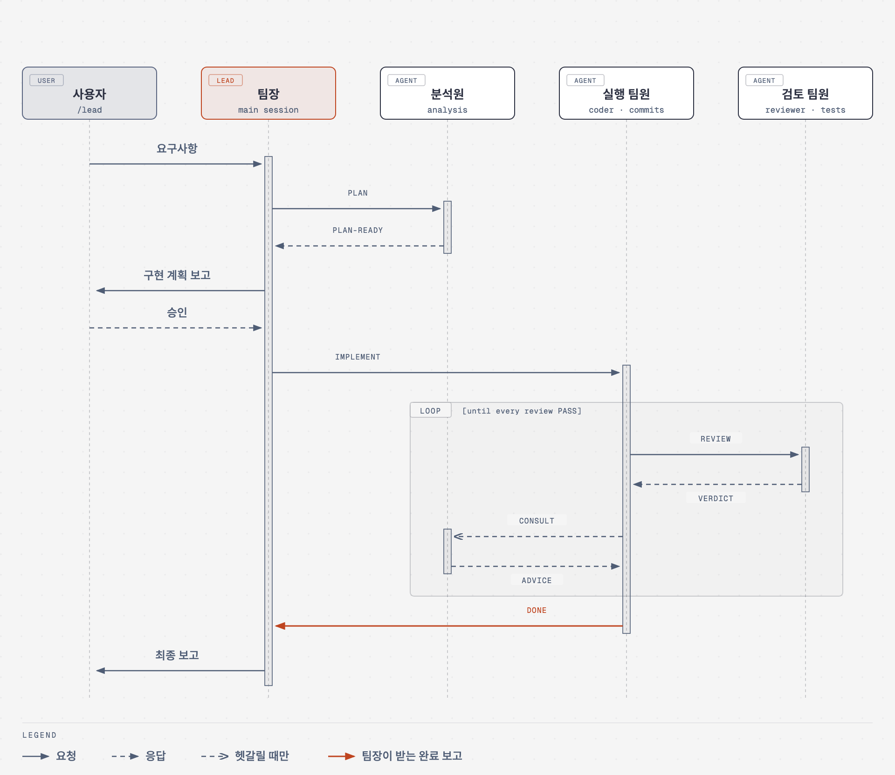
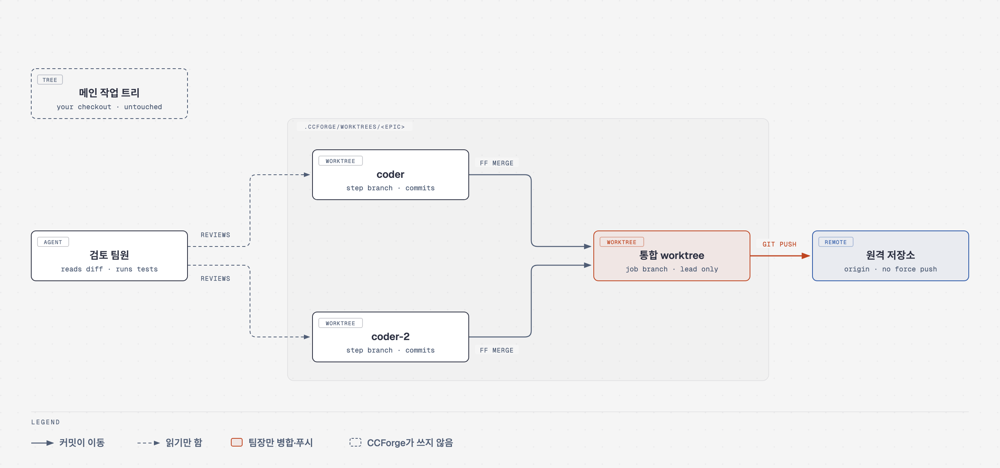

<div align="center">

# CCForge

**Claude Code agent teams로 굴러가는 코딩 팀.**<br>
팀장이 요구를 분석시켜 구현 계획을 보고하고, 승인하면 팀원들이 서로 대화하며 만들고·검토하고·커밋한 뒤 브랜치를 푸시합니다.

[빠른 시작](#빠른-시작) · [동작 방식](#동작-방식) · [설정](#설정) · [프로젝트에 맞추기](#프로젝트에-맞추기) · [FAQ](#faq) · [설계 철학](docs/philosophy.md)

</div>

<br>



```text
> /lead 결제 실패 시 재시도 로직을 추가해 줘

## 구현 계획 — 결제 실패 시 재시도
구현 방식: PaymentClient 호출을 지수 백오프 재시도로 감싼다 (최대 3회)
단계: 1. RetryPolicy 추가 — src/payment/retry.py
      2. PaymentClient에 적용 + 테스트 — src/payment/client.py, tests/...
문제점·위험: 결제 API가 멱등하지 않으면 중복 청구 가능 → idempotency key 필요
? 승인 / 수정 요청 / 중단
```

## 무엇을 해 주나

- **계획부터 보고하고 승인을 받습니다.** 분석원이 요구를 해석해 구현 방식·영향 범위·단계·문제점을 정리하면, 팀장이 한 화면으로 요약해 보고합니다. 승인해야 코드에 손을 댑니다.
- **팀원끼리 직접 대화합니다.** 실행 팀원과 검토 팀원이 전원 PASS가 날 때까지 재작업 루프를 돌고, 헷갈리는 것은 분석원에게 직접 묻습니다. 팀장에게는 완료와 예외만 올라옵니다.
- **요구가 잘못됐으면 사용자에게 돌아옵니다.** 구현이 불가능하거나 요구가 모호하면, 분석원이 대안을 정리하고 팀장이 "구체화할지, 다른 방식으로 갈지"를 묻습니다. 팀이 요구를 임의로 바꾸지 않습니다.
- **실무처럼 커밋합니다.** 논리 단위, Conventional Commits(또는 팀 규약), 재작업은 fixup 후 autosquash. 병합은 fast-forward라 커밋이 그대로 남습니다.
- **메인 작업 트리를 건드리지 않습니다.** 모든 작업은 `.ccforge/worktrees/`의 git worktree에서 하고, 끝나면 브랜치를 원격에 푸시합니다. PR 생성과 병합은 사용자 몫입니다.
- **끊겨도 이어집니다.** 상태는 전부 파일과 git에 남아 `/lead resume`으로 이어갑니다.

## 빠른 시작

**요구 사항:** [Claude Code](https://code.claude.com), git, python3(hook용).

**1. 설치** — 쓰려는 프로젝트의 `.claude/`에 복사합니다. 전역에는 아무것도 설치하지 않습니다.

```bash
git clone <이 저장소> ccforge
cd <프로젝트>
mkdir -p .claude && cp -R ../ccforge/{agents,commands,protocols,skills,hooks} .claude/
cp -Rn ../ccforge/rules .claude/      # 팀 규칙 본보기. 이미 있으면 덮어쓰지 않는다
echo '.ccforge/' >> .gitignore
```

**2. agent teams와 hook 켜기** — `<프로젝트>/.claude/settings.json`에 합칩니다.

```json
{
  "env": {
    "CLAUDE_CODE_EXPERIMENTAL_AGENT_TEAMS": "1",
    "CLAUDE_CODE_ENABLE_TODO_TOOLS": "1"
  },
  "hooks": {
    "TaskCompleted": [{ "hooks": [{ "type": "command", "command": "python3 \"$CLAUDE_PROJECT_DIR/.claude/hooks/ccforge_check.py\" task-completed" }] }],
    "TeammateIdle":  [{ "hooks": [{ "type": "command", "command": "python3 \"$CLAUDE_PROJECT_DIR/.claude/hooks/ccforge_check.py\" teammate-idle" }] }]
  }
}
```

**3. 프로젝트 정보 적기** — 저장소 루트의 `CLAUDE.md`에 언어와 테스트 명령을 적어 두면 팀원들이 읽습니다.

```markdown
- 언어: Python 3.12
- 테스트: `pytest -q`
```

**4. 실행** — Claude Code를 새로 열고:

```text
/lead calc.py에 divide(a, b)를 추가해 줘. 0으로 나누면 ValueError를 내고 테스트도 추가해 줘.
```

무인으로 돌리려면 `.claude/lead.config.json`에 `{"plan": {"require_approval": false}}`를 두고 `claude -p`로 실행합니다([FAQ](#faq) 참고).

## 동작 방식

### 팀 구성

| 역할 | 정의 파일 | 하는 일 |
|---|---|---|
| **팀장** | `commands/lead.md` (메인 세션) | 사용자 창구. 분석 요청, 계획 보고·승인, step 배정, 병합, 푸시, 최종 보고. 코드를 직접 만지지 않습니다 |
| **분석원** | `agents/analysis.md` | 요구 해석, 구현 방식·문제점·step 계획. 팀원의 질문에 답하고, 요구 자체가 문제면 대안을 정리해 팀장에게 넘깁니다 |
| **실행 팀원** | `agents/coder.md` | step 하나를 맡아 구현·테스트·커밋. 검토를 요청하고 판정에 따라 재작업합니다 |
| **검토 팀원** | `agents/reviewer.md` | 완료 기준, 워크플로 스킬 규칙, 커밋을 직접 확인하고 테스트를 다시 돌려 독립적으로 판정합니다 |

에이전트는 이 세 유형(분석형·실행형·검증형)뿐이고, 일의 종류(코드, 문서, 보안 검토 등)에 따라 달라지는 규칙은 [워크플로 스킬](#워크플로-스킬)로 넣습니다.

### 팀은 필요할 때만

[공식 문서](https://code.claude.com/docs/en/agent-teams.md)대로, agent teams는 팀원마다 컨텍스트를 따로 쓰므로 토큰이 팀원 수만큼 듭니다. 그래서 CCForge는 **동시에 돌 step이 둘 이상일 때만** 팀을 만듭니다.

| 상황 | 실행 방식 |
|---|---|
| 독립된 step이 여럿이고 서로 다른 파일을 맡음 | **팀 방식** — 분석원 1, 검토 1, 실행 2(기본 5명 안), epic 동안 유지 |
| step이 하나뿐, 작은 일, 순차 의존, `claude -p` | **순차 방식** — 같은 정의를 서브에이전트로 차례로 호출, 팀장이 메시지 전달 |

### 커밋이 원격까지 가는 길



1. 팀장이 step마다 job 브랜치 끝에서 `<branch>--step-<n>` 브랜치를 만듭니다.
2. 실행 팀원이 자기 worktree에서 커밋합니다. 재작업은 `--fixup`으로 남기고, 전원 PASS 후 autosquash로 합칩니다.
3. 팀장이 통합 worktree에서 `git merge --ff-only`로 병합합니다. 앞서 병합된 step과 충돌하면 실행 팀원이 rebase로 풀고 다시 검토받습니다.
4. 브랜치(job)가 끝나면 `git push -u`. 강제 푸시와 PR 생성은 하지 않습니다.

### 신뢰할 수 있게 만드는 장치

- **팀 규칙도 검증합니다.** 적용한 규칙마다 검토 팀원이 지켰는지 판정해 남기고, 검토가 빠뜨린 규칙 파일이 있으면 병합하지 않습니다.
- **hook이 완료 조건을 강제합니다.** `TaskCompleted`는 검토 전원 PASS, 커밋되지 않은 변경 없음을 확인해야 완료를 허락합니다. `TeammateIdle`은 할 일이 남았는데 멈춘 팀원을 세 번까지 깨우고, 그래도 안 되면 팀장에게 넘깁니다.
- **메시지가 아니라 파일로 판단합니다.** 모든 Result는 `.ccforge/workspace/`에 JSON으로 남고, step마다 `log.jsonl`에 순서대로 기록됩니다. 메시지 형식이 어긋나도 흐름이 깨지지 않습니다.
- **`.claude/`에는 쓰지 않습니다.** Claude Code는 `.claude/` 아래를 보호 경로로 다뤄 쓰기마다 확인을 받습니다. 실행 상태는 전부 `.ccforge/`에 둡니다.

## 명령어

| 명령 | 하는 일 |
|---|---|
| `/lead <요구사항>` | 새 epic 시작. 브랜치를 나누려면 요청에 그렇게 말합니다("frontend와 backend 브랜치를 따로") |
| `/lead resume [epic_id]` | 중단된 epic 이어가기 |
| `/skill-builder <요청>` | 워크플로 스킬 추가·수정·삭제 |
| `/agent-builder <요청>` | 에이전트 추가·편입·확장·삭제 |

## 설정

`.claude/lead.config.json` (선택, 없으면 기본값)

| 키 | 기본 | 뜻 |
|---|---|---|
| `parallel.max_parallel` | `3` | 동시에 도는 step 수. `1`이면 팀을 만들지 않습니다 |
| `team.max_members` | `5` | 팀원 총원 상한(분석원·검토 포함). 공식 권장은 3~5명입니다 |
| `retry.max_retries` | `3` | step마다 허용하는 재작업 횟수 |
| `job.pause_between_jobs` | `false` | 브랜치 하나가 끝날 때마다 멈추고 `resume`을 기다립니다 |
| `plan.require_approval` | `true` | 구현 계획 승인을 받고 실행합니다. 무인 실행이면 `false` |

## 프로젝트에 맞추기

| 무엇 | 어디에 | 예 |
|---|---|---|
| 언어·프레임워크·테스트 명령 | `CLAUDE.md` | `pytest -q`, `npm test` |
| 모든 작업에 적용할 팀 규칙 | `.claude/rules/common/README.md` | 테스트 필수, 비밀값 금지, 커밋 규약 |
| 특정 영역에만 적용할 규칙 | `.claude/rules/<주제>/*.md` | `rules/python/`, `rules/frontend/` |
| 산출물 종류·검증 관점 | `.claude/skills/<name>/SKILL.md` | 보안 검토, 인프라 설정 |
| 다른 도구·모델이 필요한 에이전트 | `.claude/agents/<name>.md` | 외부 스캐너로 의존성 취약점 검사 |

### 팀 규칙

```text
.claude/rules/
├── common/README.md        # 모든 step에 적용
├── python/                 # README.md의 "## 적용 대상"에 맞는 step에만 적용
│   ├── README.md           #   ## 적용 대상
│   └── typing.md           #   - `**/*.py`
└── _example/               # _로 시작하면 예시. 적용하지 않음
```

- 규칙은 한 줄에 하나(`- `)씩 쓰고, 앞에 `[유형·중요도]`를 붙일 수 있습니다(예: `[implementation·high]`). 없으면 `implementation·medium`입니다.
- 팀장이 step마다 적용할 규칙 파일을 골라 넘기고, 실행 팀원은 지키고, **검토 팀원은 규칙마다 지켰는지 `rules_check`로 남깁니다.** 위반은 그 중요도의 finding이 되고, `medium` 이상이면 재작업입니다. 팀장은 검토가 모든 규칙 파일을 다뤘는지 확인한 뒤에만 병합합니다.
- 브랜치 이름·커밋 메시지 규약도 여기 어느 파일에든 적으면 따릅니다.

### 워크플로 스킬

같은 스킬 파일을 세 유형이 함께 읽고, 각자 정해진 방식으로 씁니다. 분석원은 계획에 반영하고, 실행 팀원은 지켜서 만들고, 검토 팀원은 위반을 찾습니다. 규칙이 한 곳에만 있으니 만든 쪽과 검토하는 쪽이 같은 문장을 봅니다. 기본으로 `code-structure`(코드)와 `doc-writing`(문서·명세)이 들어 있고, `/skill-builder`로 더합니다. 규격은 [`protocols/skill-spec.md`](protocols/skill-spec.md)에 있습니다.

### 권한

무인으로 돌리려면 `.claude/settings.json`의 `permissions.allow`에 다음을 넣습니다. 테스트·빌드 명령은 프로젝트에 맞게 추가합니다.

```json
["Read", "Write", "Edit", "Glob", "Grep", "Agent", "TaskCreate", "TaskUpdate", "TaskList", "TaskGet",
 "Bash(git *)", "Bash(python3 *)", "Bash(jq *)", "Bash(mkdir *)", "Bash(mv *)", "Bash(echo *)", "Bash(date *)"]
```

## 디렉터리 구조

```text
<프로젝트>/
├── .claude/                     # CCForge가 읽기만 하는 곳
│   ├── commands/lead.md         # 팀장 절차 (/lead)
│   ├── agents/                  # analysis · coder · reviewer
│   ├── skills/                  # 워크플로 스킬 + builder + lead-resume · lead-branching
│   ├── hooks/ccforge_check.py   # TaskCompleted · TeammateIdle
│   ├── protocols/               # 에이전트·스킬 작성 규격
│   ├── rules/common/            # 공통 팀 규칙
│   ├── rules/<주제>/            # (선택) 영역별 팀 규칙
│   └── lead.config.json         # (선택) 설정
└── .ccforge/                    # 실행 중에 생기는 것 (.gitignore)
    ├── workspace/<epic>/        # epic·job 상태, step별 Task·Result·로그
    └── worktrees/<epic>/        # 통합 worktree, 팀원별 worktree
```

## FAQ

<details>
<summary><b><code>claude -p</code>(무인)로 돌릴 수 있나요?</b></summary>

됩니다. 비대화형 세션에서는 agent teams가 팀원을 만들지 않으므로 자동으로 순차 방식으로 돕니다. 승인 단계에서 멈추지 않도록 `plan.require_approval: false`를 두고, 권한은 `--allowedTools`로 줍니다.

```bash
claude -p "/lead <요구사항>" --permission-mode acceptEdits \
  --allowedTools "Read" "Write" "Edit" "Glob" "Grep" "Agent" "Bash(git *)" "Bash(python3 *)" "Bash(jq *)" "Bash(mkdir *)" "Bash(mv *)" "Bash(echo *)" "Bash(date *)"
```
</details>

<details>
<summary><b>토큰을 얼마나 쓰나요?</b></summary>

팀원마다 컨텍스트를 따로 쓰므로 팀 방식은 단일 세션보다 훨씬 많이 씁니다. 그래서 동시에 돌 일이 없으면 팀을 만들지 않고, 팀원 수를 `team.max_members`로 묶고, 관점 검토(보안 등)는 기본 검토 팀원이 함께 하며, 팀원을 epic 동안 유지해 같은 코드를 다시 읽지 않게 합니다.
</details>

<details>
<summary><b>중간에 끊기면요?</b></summary>

`/lead resume`. 팀원은 복구되지 않으므로(공식 제약) 팀장이 파일과 git으로 상태를 맞추고 팀원을 새로 만듭니다. 커밋된 것은 그대로 살리고, 커밋되지 않은 변경은 지우지 않고 stash에 둡니다.
</details>

<details>
<summary><b>브랜치는 몇 개 생기나요?</b></summary>

기본은 요청 하나에 브랜치 하나입니다. 요청에 나눠 달라고 하면 나눕니다. 기준을 말하지 않으면 분석원이 제안하고 확인을 받습니다. step 브랜치는 병합 뒤 지워집니다.
</details>

<details>
<summary><b>제약이 있나요?</b></summary>

- agent teams는 Claude Code의 실험 기능입니다. 동작이 바뀔 수 있습니다.
- 같은 저장소에서 두 세션이 동시에 `/lead`를 실행하지 않습니다.
- 브랜치(job) 사이의 병렬은 없습니다. 브랜치 안의 step만 병렬로 돕니다.
- Windows는 Git Bash 또는 WSL이 필요합니다.
- 작업 기록 형식 버전(`schema_version`)이 바뀌면 이전 epic은 `resume`할 수 없습니다.
</details>

## 문서

| 읽는 사람 | 문서 |
|---|---|
| 처음 보는 사람 | 이 README, [설계 철학](docs/philosophy.md) |
| 팀장(실행 중) | [`commands/lead.md`](commands/lead.md) |
| 각 팀원(실행 중) | [`agents/`](agents/) — 자기 정의 파일 하나로 완결 |
| 에이전트를 만드는 사람 | [`protocols/task-result.md`](protocols/task-result.md) |
| 워크플로 스킬을 만드는 사람 | [`protocols/skill-spec.md`](protocols/skill-spec.md) |

## 참고

CCForge의 팀 구조와 제약은 Anthropic의 글을 기준으로 맞췄습니다.

- [Orchestrate teams of Claude Code sessions](https://code.claude.com/docs/en/agent-teams.md) — agent teams 동작, 권장 팀 크기, 파일 소유 분리, 제약
- [Hooks reference](https://code.claude.com/docs/en/hooks.md) — `TaskCompleted`, `TeammateIdle`
- [How we built our multi-agent research system](https://www.anthropic.com/engineering/multi-agent-research-system) — 리드-워커 구조, 작업 경계와 출력 형식을 분명히 주기
